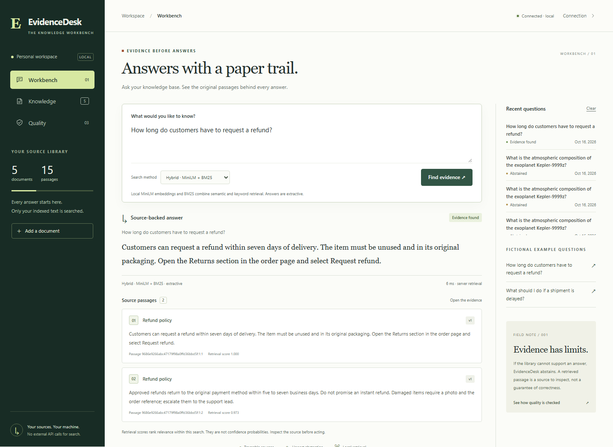
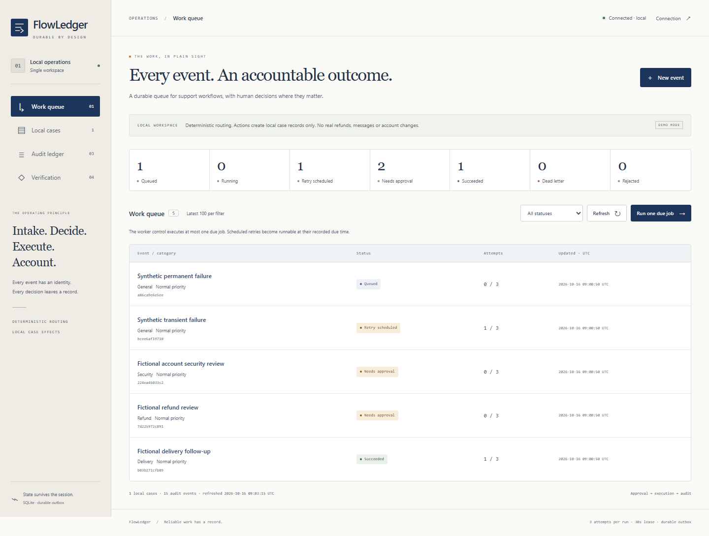

  

<h1 align="center">Deboraj Sarkar · Debotaro</h1>

<strong>AI Software &amp; Automation Developer Python APIs, Retrieval &amp; Reliable Workflows | Computer Science Student</strong>

  <a href="https://debotaro.github.io/">Portfolio</a> ·
  <a href="https://debotaro.github.io/downloads/Deboraj-Sarkar-Resume.pdf">Résumé PDF</a> ·
  <a href="https://www.linkedin.com/in/deborajsarkar/">LinkedIn</a> ·
  <a href="https://dribbble.com/Debotaro">Dribbble</a> ·
  <a href="mailto:mail.deborajsarkar@gmail.com">Email</a>

**Seeking junior and associate software, applied AI and automation opportunities.** Based in Kokrajhar, Assam, India; open to remote opportunities.

I'm building personal software projects around source evidence, recoverable workflows and clear interfaces. My paid graphic design background informs how I make a system's state and next action understandable. I'm studying for a bachelor's degree in Computer Science at the University of the People (June 2025–present). Previously, I worked as a Graphic Designer at Wecanstore.com (June 2022–July 2023), creating banners, social graphics and marketing materials.

Personal projects developed with **Codex assistance**. The repositories and case studies document implementation, executable checks and limits. Project selection and implementation for EvidenceDesk and FlowLedger were delegated to Codex under my portfolio mission; their capabilities are evidence about the software, not independently assessed individual proficiency or prior AI engineering employment. For the earlier interface collection, my owner-reported contribution covers visual direction, review and iteration.

## Applied AI & reliable automation

### EvidenceDesk · Local validation

A support knowledge workbench that versions policies and runbooks, compares BM25 with real local MiniLM embeddings, returns cited source excerpts and can abstain when a question is unsupported. Python/FastAPI, SQLite and a browser interface connect ingestion, retrieval, query history and deletion.

Responses are extractive. On 16 October 2026, hybrid retrieval found supporting sources in 14/18 answerable synthetic holdout questions at Recall@3, versus 11/18 for BM25; all 8 unsupported/adversarial holdout questions were refused, with 100% citation snapshot traceability. Forty-six backend tests and Ruff checks passed locally. The small fixture measures retrieval, refusal and source integrity, not generative LLM quality or customer impact. Public source and service hosting await approval.

### FlowLedger · Local validation

A complete bounded Python/FastAPI workflow service with typed events, deterministic routing, approval decisions, a transactional outbox, fenced worker leases, bounded retries and an inspectable audit trail. A separate polling worker executes real persistent local case actions.

On 16 October 2026, 20 backend tests and Ruff checks passed, together with 9/9 isolated local SQLite experiments. Twelve concurrent repeated submissions created one job; eight workers completed 16 jobs with zero duplicate local cases. Real subprocess exits after effect commit and before acknowledgement on first and final attempts recovered one local case in each experiment, using an explicit one-second lease override. Retry/lease boundary checks use injected UTC. This is local effect reconciliation, not a general exactly-once guarantee, external integration or customer outcome. Public source and service hosting await approval.

The portfolio's local review edition includes separate case-study pages for these projects. Public links will be added after approved publication; no unavailable repository or hosted-demo URL is presented here.

## Flagship project · Debotaro Studio

A visual application builder that connects responsive design with a documented React/TypeScript code subset. Its fictional support workspace has working search, filters, ticket details and assignment.

**My contribution:** product direction, target audience, requirements and visual goals. Implementation was developed with Codex through documented contracts, review and executable verification.

**What works:** visual editing, reusable components/tokens, desktop/tablet/phone preview, inspected TSX changes, authenticated collaboration, offline recovery, version history and independent React project export.

**Evidence and limits:** the dated verification ledger distinguishes local automated/browser runs from historical clean independent-export checks. These are technical checks, not business or adoption metrics. Studio needs a Node/WebSocket service and persistent SQLite; live AI inference remains unverified and the backend is not externally hosted at the documented checkpoint.

[Case study](https://github.com/Debotaro/debotaro-studio/blob/main/docs/CASE_STUDY.md) · [Source and local setup](https://github.com/Debotaro/debotaro-studio) · [Verification](https://github.com/Debotaro/debotaro-studio/blob/main/docs/VERIFICATION.md)

## More product interfaces

| Project       | Focus                                                                                  | Technologies                             | Explore                                                                                                                                                                                                                             |
| ------------- | -------------------------------------------------------------------------------------- | ---------------------------------------- | ----------------------------------------------------------------------------------------------------------------------------------------------------------------------------------------------------------------------------------- |
| **RELAY OS**  | Artwork revisions, pinned feedback and approval decisions in a creative review studio  | React, TypeScript, Vite                  | [Demo](https://debotaro.github.io/relay-os/) · [Case study](https://github.com/Debotaro/Debotaro.github.io/blob/main/CASE_STUDIES.md) · [Source](https://github.com/Debotaro/Debotaro.github.io/tree/main/relay-os)                 |
| **NOVA OS**   | Daily agenda, task-linked focus, project notebooks and public GitHub milestone imports | Next.js, React, TypeScript, Tailwind CSS | [Demo](https://debotaro.github.io/nova-os/app/) · [Case study](https://github.com/Debotaro/Debotaro.github.io/blob/main/reports/case-studies/NOVA.md) · [Source](https://github.com/Debotaro/Debotaro.github.io/tree/main/nova-os)  |
| **ATLAS Ops** | Operations charts, task boards and public GitHub issue imports                         | React, TypeScript, Vite, Recharts        | [Demo](https://debotaro.github.io/atlas-ops/) · [Case study](https://github.com/Debotaro/Debotaro.github.io/blob/main/reports/case-studies/ATLAS.md) · [Source](https://github.com/Debotaro/Debotaro.github.io/tree/main/atlas-ops) |

These are personal concepts using sample records and browser-local state. NOVA and ATLAS read public GitHub data; imports remain local. RELAY's optional backend requires separate configuration.

## More from the collection

**Finance and brand experiences:** [NILA Ledger](https://debotaro.github.io/nila-ledger/) · [AURA Reserve](https://debotaro.github.io/aura/) · [VANTA Atelier](https://debotaro.github.io/vanta/) · [RASA Experience](https://debotaro.github.io/rasa/)

**Offline learning tools:** [Debotaro CHSL](https://debotaro.github.io/ssc-chsl/) · [Debotaro Rail](https://debotaro.github.io/rrb-ntpc/) · [Debotaro Assam](https://debotaro.github.io/adre-hs/)

[Explore all ten demos and the portfolio case study](https://debotaro.github.io/) · [Read implementation notes](https://github.com/Debotaro/Debotaro.github.io/blob/main/CASE_STUDIES.md) · [Review validation and scope](https://github.com/Debotaro/Debotaro.github.io/blob/main/VALIDATION.md)

## Technologies used in projects

**Applied AI and automation:** Python · FastAPI · SQLite · information retrieval · BM25 · local embeddings · API validation · workflow reliability

**Frontend:** React · Next.js · TypeScript · JavaScript · HTML · CSS · Tailwind CSS

**Tools and workflow:** Git · GitHub · Figma · Codex · Visual review and design iteration

Project technologies describe the software artifacts; they do not establish independently assessed proficiency. EvidenceDesk and FlowLedger are locally verified; public source release and service hosting await approval.

## Education and selected learning

- **Bachelor's degree in Computer Science, in progress** — University of the People, June 2025–present
- [Google UX Design Professional Certificate](https://www.coursera.org/account/accomplishments/specialization/ZR76Q3CG6VAX) — Google / Coursera, November 2023
- [IBM DevOps, Cloud, and Agile Foundations Specialization](https://www.coursera.org/account/accomplishments/specialization/ZS82DMJQ6E5H) — IBM / Coursera, April 2023
  The certificates above are completed course credentials issued through Coursera.

---

**Contact:** [mail.deborajsarkar@gmail.com](mailto:mail.deborajsarkar@gmail.com)
